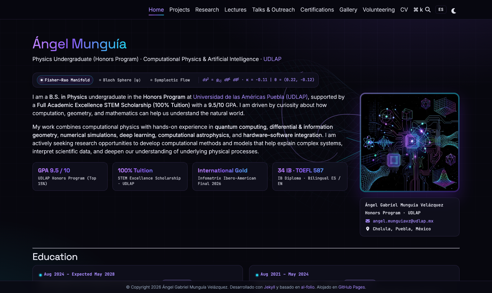
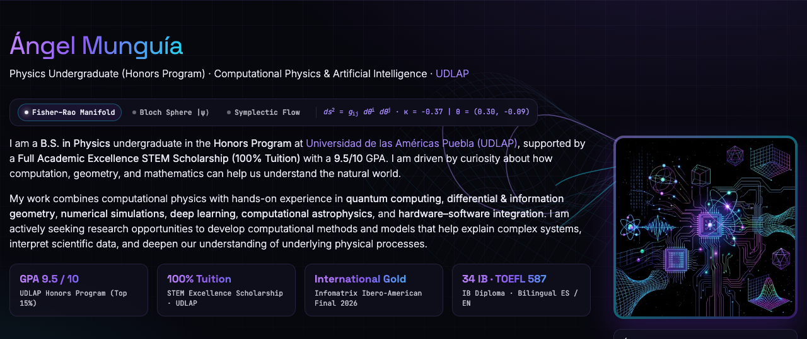
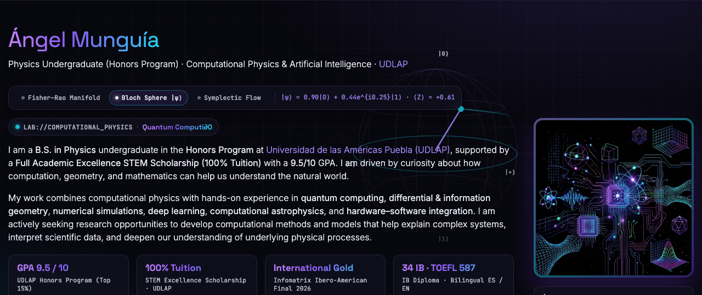
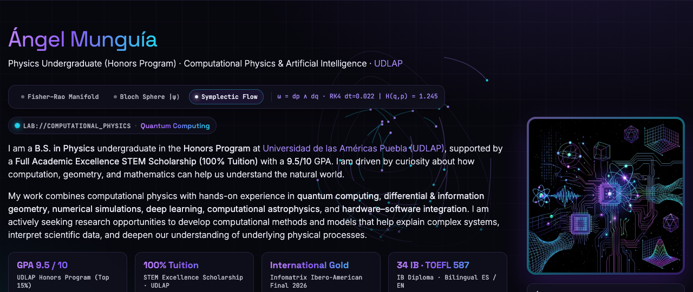
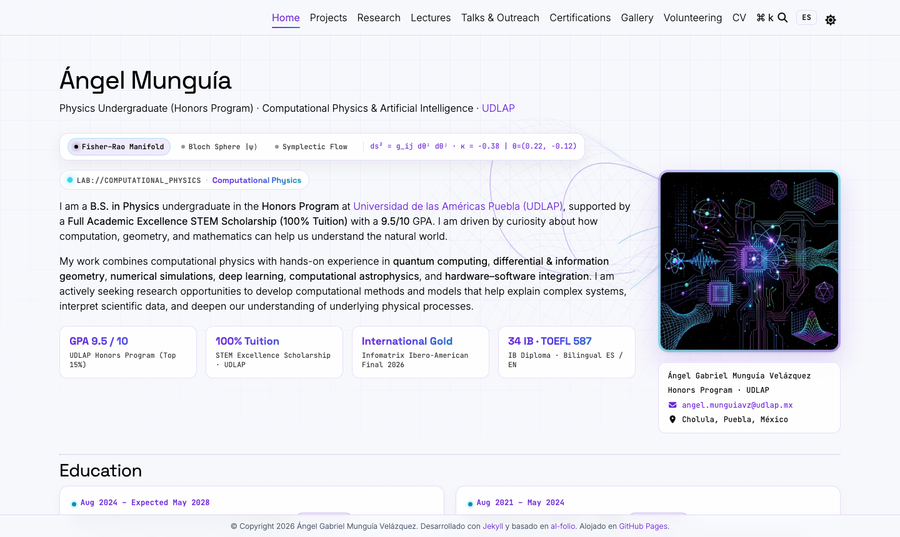
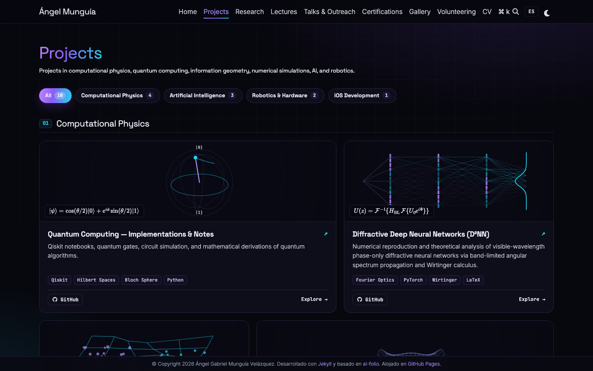
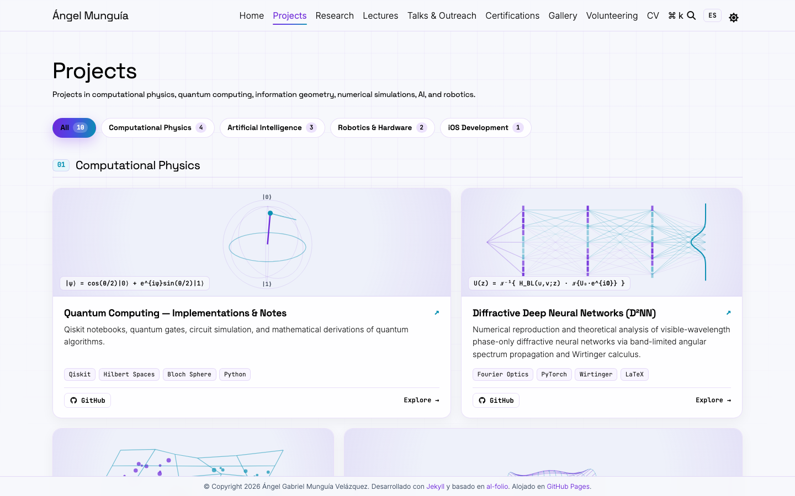
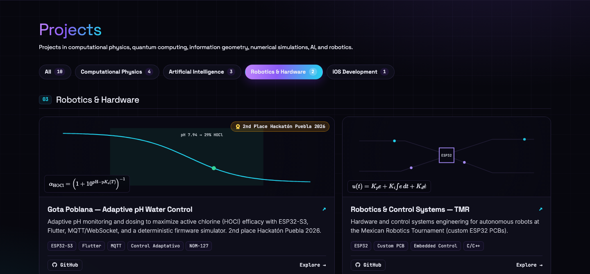
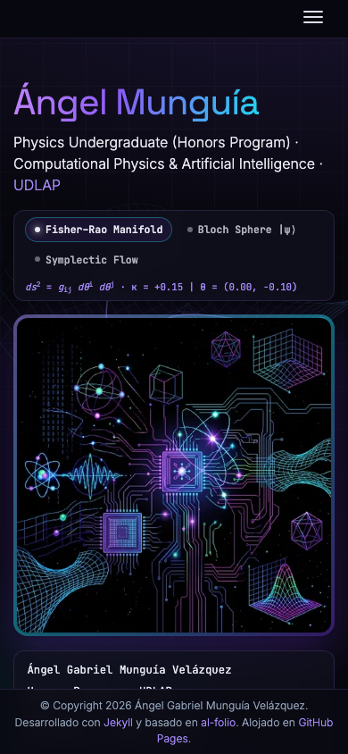
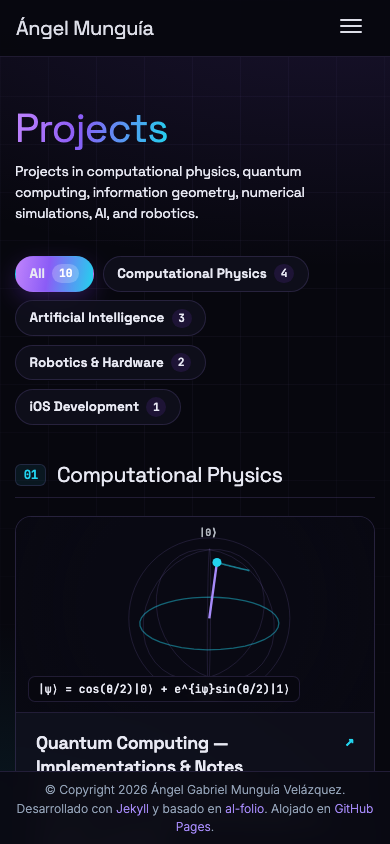

# AngelGab3.github.io — Computational Physics Portfolio

<div align="center">

[](https://angelgab3.github.io)
[](https://github.com/AngelGab3/AngelGab3.github.io/actions/workflows/deploy.yml)
[](https://github.com/alshedivat/al-folio)
[](#key-features)
[](LICENSE)

<br/>



<p><i>"Exploring the natural world through computation, differential geometry, and quantum mechanics."</i></p>

</div>

---

## Overview & Philosophy

Academic and engineering portfolio built on top of [`al-folio`](https://github.com/alshedivat/al-folio) (pluginized v1.x) and upgraded with a zero-dependency **Canvas 2D mathematical simulation engine**, interactive **Computational Bento Grid**, **cursor-reactive glassmorphism**, and native **View Transitions**.

- **Author:** Ángel Gabriel Munguía Velázquez
- **Affiliation:** B.S. in Physics (Honors Program) · Universidad de las Américas Puebla (UDLAP)
- **Focus:** Computational Physics · Quantum Computing · Information Geometry · Numerical Simulations · Deep Learning & Embedded Control
- **Themes:** Obsidian Lab (`#07070e`) & Scientific Blueprint (`#f7f8fc`) with violet-to-cyan accents
- **Typography:** `Space Grotesk` (headings) · `Inter` (body) · `JetBrains Mono` (equations, metrics, telemetry)

---

## Gallery

### Interactive Mathematical Hero (3 Live Simulation Modes)

An interactive HUD above the hero lets visitors switch between three real-time 3D projections that respond to cursor motion and live telemetry updates:

<table align="center">
  <tr>
    <th width="33.3%">Fisher–Rao Manifold</th>
    <th width="33.3%">Bloch Sphere |ψ⟩</th>
    <th width="33.3%">Symplectic Flow (RK4)</th>
  </tr>
  <tr>
    <td></td>
    <td></td>
    <td></td>
  </tr>
</table>

### Adaptive Theme System (Dark vs. Light)

Switching themes triggers a circular View Transitions reveal expanding from the toggle button while immediately updating all Canvas 2D palettes and CSS surface tokens.

<table align="center">
  <tr>
    <th width="50%">Obsidian Dark Mode</th>
    <th width="50%">Scientific Blueprint Light Mode</th>
  </tr>
  <tr>
    <td></td>
    <td></td>
  </tr>
  <tr>
    <td></td>
    <td></td>
  </tr>
</table>

### Applied Hardware & Control Showcase

Each project card renders a bespoke real-time simulation inside the Bento Grid (here filtered to **Robotics & Hardware**, highlighting **Gota Poblana**'s $\alpha_{\mathrm{HOCl}}(\mathrm{pH})$ curve under NOM-127 and **TMR Robotics**'s ESP32 PCB telemetry pulses).

<div align="center">
  
</div>

### Responsive Mobile View

<table align="center">
  <tr>
    <th width="50%">Mobile Homepage</th>
    <th width="50%">Mobile Bento Grid</th>
  </tr>
  <tr>
    <td align="center"></td>
    <td align="center"></td>
  </tr>
</table>

---

## Tech Stack

| Component                  | Tool                             | Notes                                                                                        |
| :------------------------- | :------------------------------- | :------------------------------------------------------------------------------------------- |
| **Static Engine**          | Jekyll 4.4 (`al-folio` v1.x)     | Thin-starter architecture (`al_folio_core`, `al_icons`, `al_math`)                           |
| **Math Simulation Engine** | `assets/js/quantum-lab.js`       | Zero-dependency Canvas 2D engine: 3 hero modes + 10 per-project simulations                  |
| **Motion & UX**            | `assets/js/site-enhancements.js` | Circular theme View Transition, 3D tilt, spotlight glow, scramble decoder, counters, filters |
| **Styling**                | `assets/css/custom.css`          | Glassmorphism, 48 px coordinate grid, Bento Grid, `prefers-reduced-motion` rules             |
| **Typography**             | Google Fonts                     | `Space Grotesk`, `Inter`, `JetBrains Mono`                                                   |
| **Bilingual Engine**       | `_plugins/site_hooks.rb` + JS    | Instant `ES / EN` switching persisted in `localStorage` without page reloads                 |
| **Photo Galleries**        | `_plugins/eventos_generator.rb`  | Automatic event galleries powered by PhotoSwipe v5.4.4                                       |
| **CI / Deployment**        | GitHub Actions                   | `deploy.yml` (GitHub Pages), `prettier.yml`, `broken-links-site.yml`                         |

---

## Key Features

- **10 Custom Project Simulations:** Dedicated procedural visualizations for Bloch sphere qubits (`bloch`), phase-only diffractive optical neural networks (`diffraction`), DESOM galaxy clustering (`som-galaxy`), Riemannian manifolds (`manifold`), YOLO edge vision (`vision-scan`), LSTM orbital forecasting (`orbital-forecast`), natural gradient flows (`latent-flow`), $\alpha_{\mathrm{HOCl}}$ adaptive pH dosing (`hocl-control`), ESP32 PCB signals (`pcb-signal`), and harmonic orbits (`swift-orbit`).
- **Performance-First Canvas Loop:** Single shared `requestAnimationFrame` loop gated by `IntersectionObserver` and `document.hidden`, capped at `2×` DPR, with automatic static fallback under `prefers-reduced-motion`.
- **Clean Starter Boundaries:** All customizations live inside `assets/`, `_pages/`, `_projects/`, and `_plugins/` without overriding `al_folio_core` layouts or Tailwind build pipelines (verified via `npm run lint:style-contract`).
- **Reproducible Gallery Script:** `scripts/capture_readme_screenshots.mjs` regenerates all screenshots in `docs/screenshots/` directly from `_site/` using Playwright.

---

## Repository Structure

```text
AngelGab3.github.io/
├── _config.yml                      # Site metadata, fonts, plugins, and Jekyll exclusions
├── _data/                           # CV, socials, citations, and repository data
├── _pages/                          # Bilingual pages (about, projects Bento grid, research, CV, gallery)
├── _plugins/
│   ├── eventos_generator.rb         # Event photo gallery generator (PhotoSwipe)
│   └── site_hooks.rb                # Head/body injection (lang init, custom.css, quantum-lab.js)
├── _projects/                       # 10 computational physics, AI, robotics, and iOS project entries
├── assets/
│   ├── css/custom.css               # Complete visual system, Bento Grid, and motion rules
│   ├── img/                         # Profile artwork and event photography
│   ├── js/
│   │   ├── quantum-lab.js           # Mathematical Canvas 2D hero & Bento simulation engine
│   │   └── site-enhancements.js     # Bilingual UI, PhotoSwipe, spotlight, tilt, counters, filters
│   └── pdf/                         # Academic CV PDF
├── docs/
│   ├── screenshots/                 # Automated Playwright screenshots (excluded from Jekyll _site)
│   ├── BOUNDARIES.md                # al-folio v1 starter-vs-plugin ownership contract
│   └── GUIA.md                      # Maintenance guide (Spanish)
├── scripts/
│   ├── capture_readme_screenshots.mjs
│   └── process_event_photos.py
└── test/                            # Starter style contract and integration checks
```

---

## Local Development

```bash
# 1. Install Ruby & Node dependencies
bundle install
npm ci

# 2. Serve the site locally (http://127.0.0.1:4000)
bundle exec jekyll serve

# 3. Validate starter contract and formatting
npm run lint:style-contract
npm run lint:prettier

# 4. Rebuild and refresh README screenshots
bundle exec jekyll build
node scripts/capture_readme_screenshots.mjs
```

---

<div align="center">
  Built with <a href="https://jekyllrb.com/">Jekyll</a> and <a href="https://github.com/alshedivat/al-folio">al-folio</a> · <a href="https://angelgab3.github.io">angelgab3.github.io</a>
</div>
